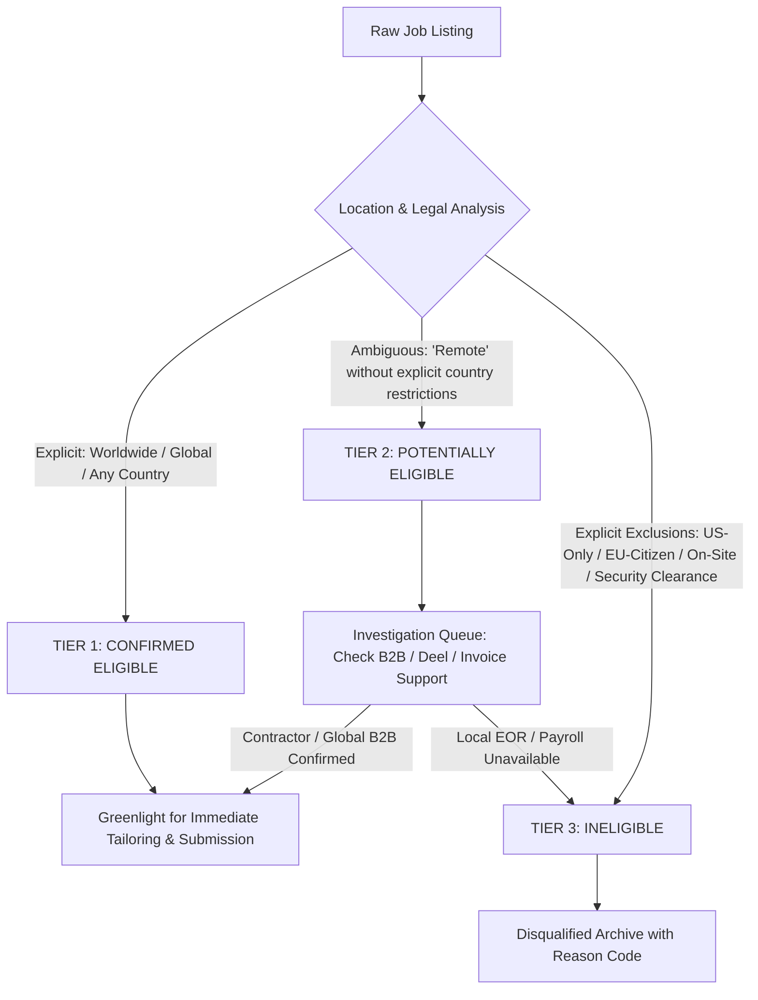
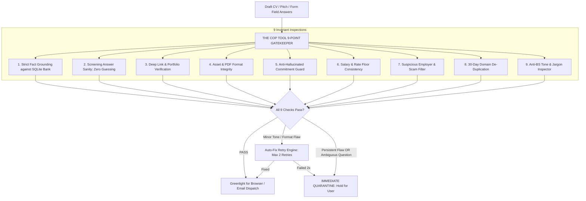

# Reygent: Autonomous Job-Search & Career Operator
## Comprehensive System Design Specification

---

### 1. System Vision & Adaptive Objective Function

**Reygent** is an autonomous career operator engineered to discover, qualify, apply for, pitch, and convert remote software engineering and AI opportunities (contracts, fractional retainers, and full-time roles) for a candidate based in **Cameroon (Central/West Africa, UTC+1)**, operating under an adaptive learning loop until a sustainable monthly income goal is secured across 2 to 3 compatible engagements.

#### 1.1 Empirical Optimization Formulation

Rather than assuming fixed channel weights or theoretical response rates, the agent treats channel allocation as an **Adaptive Multi-Armed Bandit (MAB)** problem:

$$\max_{\pi \in \Pi} \mathbb{E} \left[ \sum_{t=0}^{\infty} \gamma^t \cdot \sum_{k \in \mathcal{K}} w_k(t) \cdot \mathcal{U}_k(s_t, a_{k,t}) - \mathcal{C}_{\text{measured}}(a_t) \right]$$

Where:
- **Channels $\mathcal{K}$**:
  1. $\mathcal{K}_1$: Direct Founder Outreach (X, HN, AI Discords)
  2. $\mathcal{K}_2$: Inbound ATS Applications (Greenhouse, Ashby, Lever)
  3. $\mathcal{K}_3$: Direct Recruiter Outreach
  4. $\mathcal{K}_4$: Contract & Fractional Gigs (Wellfound, Seed startups)
- **Channel Weights $w_k(t)$**: Initialized equally ($25\%$ exploration across all 4 channels during the $N=50$ Calibration Cohort) and dynamically adjusted via Upper Confidence Bound (UCB1) based on:
  - Qualified opportunities identified per hour of crawl.
  - Verified responses per 100 applications/outreach attempts.
  - First-round interviews generated.
  - Expected compensation velocity.
  - Measured execution cost and candidate time spent.
- **Stopping Rule**:
  $$\text{GoalAchieved} \iff \sum_{o \in \mathcal{O}_{\text{accepted}}} \text{MonthlyRevenue}(o) \ge \text{IncomeGoal}$$

---

### 2. Cameroon-Specific 3-Tier Remote Eligibility Engine

A posting containing the word *"Remote"* is frequently restricted by national payroll laws or timezone constraints. The eligibility engine enforces a rigorous **3-Tier Classification Model** specifically calibrated for a candidate based in **Cameroon (UTC+1)**:

#### Tier Definitions:
1. **Tier 1: Confirmed Eligible**
   - Explicitly states: *"Remote Worldwide"*, *"Remote (Anywhere)"*, *"Global Remote"*, *"Any Timezone"*, or lists Africa/EMEA coverage.
   - Contract type supports direct B2B invoicing, international wire, or contractor platforms (Deel, Remote.com, Oyster, Wise).
2. **Tier 2: Potentially Eligible (Investigate, Do Not Discard)**
   - Stated as *"Remote"* without explicit geographic exclusions, but employer country is US/EU/UK.
   - **Protocol**: Listing is **not** discarded. The agent checks contractor compatibility, pitches direct B2B availability, and flags for confirmation if a strict citizenship dropdown appears.
3. **Tier 3: Ineligible (Hard Disqualification)**
   - Requires active US Security Clearance, US Citizenship, green card, or specific local PAYE tax residency.
   - Requires mandatory physical on-site presence.
   - Rate below minimum threshold (\$40/hr or \$2,500/mo retainer).

---

### 3. Hardened 9-Point Cop Tool Invariant Suite

To guarantee that Reygent never "runs loose", damages candidate reputation, hallucinates credentials, or submits invalid data, **The Cop Tool** enforces a 9-point pre-dispatch validation suite:

#### Detailed Invariant Rules:
1. **Strict Fact-Grounding**: Every achievement metric, technology, company name, and date must have an exact semantic entailment match in the verified SQLite achievement bank.
2. **Screening Answer Sanity (Zero-Guessing Rule)**: Novel, ambiguous, or multi-choice screening questions regarding work status or tax are **immediately quarantined**—never guessed.
3. **Deep Link & Portfolio Verification**: Confirms page title matches and GitHub repositories exist, are public, and are non-empty.
4. **Asset & PDF Integrity**: Validates compiled PDF resumes have non-zero file sizes (>10KB), valid page counts (1–2 pages), and zero overlapping text layers.
5. **Anti-Hallucinated Commitment Guard**: Rejects any text that promises on-site presence or unverified notice periods.
6. **Salary & Rate Floor Consistency**: Ensures submitted rates never fall below the configured floor (\$40/hr or \$2,500/mo).
7. **Suspicious Employer & Scam Detector**: Flags unverified domains, anonymous Telegram recruiters, or pay-to-work schemes.
8. **30-Day Domain & Contact De-Duplication**: Prevents contacting the same company or domain more than once in 30 days.
9. **Anti-BS Tone & Jargon Inspector**: Strips sycophantic fluff and AI clichés; enforces clean senior peer-to-peer engineering tone.

---

### 4. Instrumented Cost Ledger & Circuit-Breaker Architecture

- **Tier 0 (\$0.00)**: Local deterministic Python heuristics (regex, deduplication, country code filters).
- **Tier 1 (Decisions — TypeSafe AI Jev System-One)**: Single-pass discriminative model returning strongly typed booleans, enums, and calibrated probabilities at **$\sim \$0.02$ per 1,000 decisions**.
- **Tier 2 (Generation — Fireworks AI Serverless)**: Low-cost Llama 3.3 70B / Qwen 2.5 serverless inference used exclusively when text generation is required at $\sim \$0.20$–$\$0.50$ per 1M tokens.
- **Instrumented Cost Ledger**: Tracks prompt tokens, completion tokens, model latency, and billed dollar amounts down to $\$0.00001$.
- **Hard Circuit Breaker**: **\$1.50 / day spend cap**; execution automatically pauses and alerts via macOS notification if daily spend exceeds threshold.

---

### 5. Local-First Playwright Browser Operator

- **Host Execution**: Runs natively and headlessly on your Mac at **\$0.00 infrastructure cost** using your natural residential IP.
- **Persistent User Profile**: Stores cookies, session tokens, and localStorage in `~/.reygent/browser_profile/default`.
- **Headless with On-Demand Headful MFA**: Operates headlessly; surfaces a visible window and fires a macOS desktop notification via `osascript` only when a 2FA code is needed, then returns to headless mode.
- **Token-Saving Semantic DOM Extractor**: An in-page script extracts a tiny, normalized $\sim 300\text{-byte}$ form schema. **Jev System-One** maps fields to verified facts in a single forward pass ($\le 50\text{ms}$).

---

### 6. Pragmatic 3-Stage Empirical Rollout Plan

- **Stage 01: Build the Reliable Core**: Fact bank with Cameroon/B2B context, 3-tier eligibility filters, Jev & Fireworks wrappers, local Playwright, persistent SQLite queue, and The Cop Tool.
- **Stage 02: Run 50 Real Applications (The Calibration Cohort)**: Exactly 50 real submissions with mandatory human review of every CV and answer to establish baseline conversion and measured costs.
- **Stage 03: Outbound Expansion & Adaptive Scaling**: Launch direct founder outreach (X, HN, Discord), enable UCB1 adaptive allocation, and scale to 25–45 touches/day until the cumulative income goal is reached.
